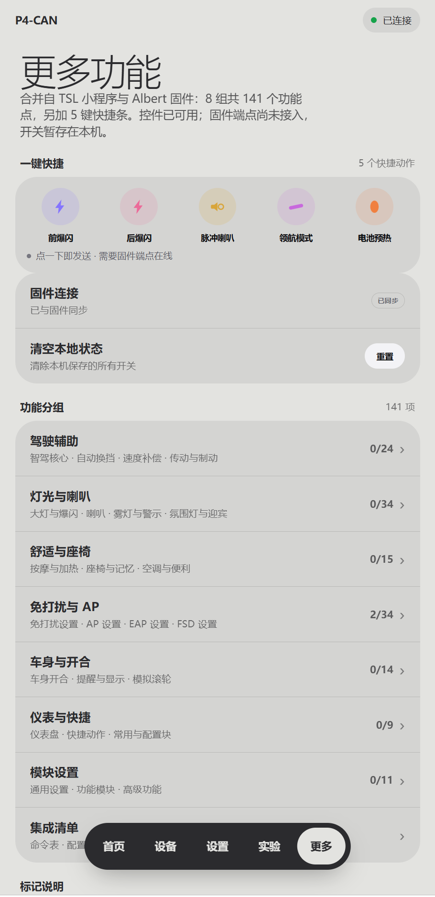

# P4can-unlock-more

> [!WARNING]
> **32 MB flash only** (Waveshare ESP32-P4-WIFI6 / rev3.2).
> The `app5M_fat24M_32MB` partition table does not fit a 16 MB board — flashing
> this image on 16 MB **bricks it**, and you will need USB to recover.
> For 16 MB you must build your own partition table, switch `FlashSize=32M` to
> `16M` and pick a 16 MB `PartitionScheme` before compiling. No 16 MB config
> ships with this repo.

Tesla CAN toolkit firmware for the **Waveshare ESP32-P4 WiFi6 3×TWAI** board.
Based on [P4can-universal-unlock](https://github.com/06066060606060/P4can-universal-unlock)
`v3.29.3`, with a new **More features** page and a firmware-update panel that
actually works end to end.



## Status — read this first

| | Status | Notes |
|---|---|---|
| More features page | ✅ works | 8 groups / 141 entries, bilingual, all controls self-tested |
| Firmware update (OTA) | ✅ works | upload a `.bin` in the browser, A/B partitions, rollback on failure |
| Local simulator | ✅ works | `sim/p4can-sim.html`, open it directly, no hardware |
| **`/api/feifan/*` endpoints** | ❌ **not implemented** | UI state is kept in `localStorage` only — nothing reaches CAN yet |

The front end is fully integrated into the stock dashboard; the five
`/api/feifan/*` handlers in `web_api.h` are still TODO. Flipping a switch will
remember its state but will not move the car. [docs/PROTOCOL.md](docs/PROTOCOL.md)
documents the frames and bit-fields needed to finish them.

## What is inside

**More features page** — 141 entries across 8 groups (driver assist, lights &
horn, comfort & seats, nag/AP, body & closures, cluster & shortcuts, module
settings, plus an integration index). Every entry carries an evidence grade:

- `A` — bit offset, mask and command byte read from the decompiled `SETTINGS` array
- `B` — naming/structure from the UI design mock-ups only, no matching frame found
- `C` — pure front-end behaviour, no hardware dependency

Writes go through the TSL config block: read `byte[offset] >>> shift & mask`,
clear, set, then write the whole block back with `CMD 163 (0xA3)`.
Shortcut actions use `CMD 187 (0xBB)` with a single-byte value.

**Firmware update panel** — adds partition headroom, current version, drag and
drop, size/magic pre-checks, tap-twice confirmation, upload progress and
`Update.errorString()` translation on top of the stock `POST /update`.

**Bilingual UI** — the dashboard ships in Chinese by default; the language switch
in the header flips to English and the choice is kept in `localStorage`. Dynamically
built strings (`Uploading 42%`) are patched via `MutationObserver`; technical
identifiers stay untranslated in Chinese mode.

## Flashing

Grab a build from [Releases](../../releases).

**`*-ota.bin` (~1.4 MB)** — for routine updates: connect to the P4 hotspot,
open `http://192.168.4.1` → Settings → Firmware update, pick the file, tap twice.
OTA only writes the app partition — bootloader, partition table and flash
parameters cannot be changed this way.

**`*-full.bin` (32 MB)** — first flash or unbrick:

```bash
esptool.py --chip esp32p4 -p <PORT> -b 460800 write_flash 0x0 P4can-unlock-more-v3.29.3-more1117-full.bin
```

ESP32-P4 layout differs from S3: `0x2000` bootloader (`E9`), `0x8000` partition
table (`AA50`), `0x10000` app (`E9`); `0x0` is blank `0xFF`.

## Build from source

Arduino-ESP32 core **3.3.12**, `firmware/P4can-unlock-more/` is the sketch:

```text
esp32:esp32:esp32p4:ChipVariant=postv3,FlashSize=32M,PartitionScheme=app5M_fat24M_32MB,PSRAM=enabled,USBMode=hwcdc,CDCOnBoot=cdc,FlashMode=qio
```

```bash
python tools/more/pack_ota.py            # rebuild page → compile → pack → verify
python tools/more/pack_ota.py --no-html  # page unchanged
python tools/more/pack_ota.py --dry-run  # environment check only
```

The script aborts instead of shipping a bad image: it rejects anything larger
than `0x480000`, anything whose first byte is not `0xE9`, any `merged.bin` that
is not 32 MB with valid magic at the three offsets, and any image whose embedded
gzip page does not match `dashboard_source.html` byte for byte.

## Local preview

```bash
python tools/more/build_sim.py
```

Extracts the page from `index_html.h`, injects a fake backend and writes
`sim/p4can-sim.html`. Open it and click through the whole flow; the SIM panel
shows every request with method, path and payload. Debugging aid only — not a
substitute for hardware testing.

## Layout

```text
firmware/P4can-unlock-more/   sketch (.ino, headers, dashboard)
tools/more/                   generators, injectors, packer, simulator builder
data/feifan-menu-data.json    141 entries, 44 bit-fields, command/API tables
docs/                         FEATURES / PROTOCOL / OTA / REVERSE
sim/p4can-sim.html            ready-to-open simulator
```

### Documentation

| Doc | Contents |
|---|---|
| [docs/FEATURES.md](docs/FEATURES.md) | all 141 entries with evidence grade, frame/bit-field, landing status |
| [docs/PROTOCOL.md](docs/PROTOCOL.md) | frame format, command bytes, 44 bit-fields, `0xBB` values, API contract |
| [docs/OTA.md](docs/OTA.md) | partitions, rollback, the 7 packing steps, acceptance checks |
| [docs/REVERSE.md](docs/REVERSE.md) | how the three sources were unpacked, corrections, dedup rules |

## Hardware

Waveshare ESP32-P4-WIFI6, rev3.2, 32 MB flash, `app5M_fat24M_32MB` partition
scheme. `ota_0` / `ota_1` are `0x480000` (4.5 MB) each; the per-image ceiling is
4,718,592 B.

| Bus | TWAI | TX | RX |
|---|---|---|---|
| CAN 1 BODY | 0 | GPIO20 | GPIO21 |
| CAN 2 CHASSIS | 1 | GPIO22 | GPIO23 |
| CAN 3 PARTY | 2 | GPIO26 | GPIO27 |

## Known limitations

- The five `/api/feifan/*` endpoints are missing; writes never reach CAN.
- `0x249 / 0x10C / 0x3E2 / 0x3E3` from the design mock-ups appear zero times in
  either firmware. Those features were rewritten against real bit-fields; the
  frame IDs are footnotes, do not send them.
- Partition table, bootloader and flash parameters require a wired flash.
- No write behaviour has been validated on a real car.

## Safety

Built for **closed-course debugging**. Changing lighting, horn, nag suppression
or driver-monitor behaviour on public roads may be illegal and may put the
vehicle into a non-certified state. Use at your own risk; the authors accept no
liability. Not affiliated with Tesla, Inc.

## Support the project

> Free and open source. If it saved you an evening of debugging, you can buy the
> author a coffee.

<table>
  <tr>
    <td align="center"><br><sub><b>Alipay</b></sub></td>
    <td align="center"><br><sub><b>WeChat Pay</b></sub></td>
  </tr>
</table>

## Contact

<table>
  <tr>
    <td align="center"><br><sub><b>Douyin · @耶基大学懂事长</b><br>ID <code>yejiuni</code></sub></td>
    <td align="center"><br><sub><b>WeChat · scan to add</b></sub></td>
  </tr>
</table>

## License

Additions are MIT — see [LICENSE](LICENSE). The firmware baseline keeps its
upstream terms — see [NOTICE](NOTICE).

---

[中文](README.md)
