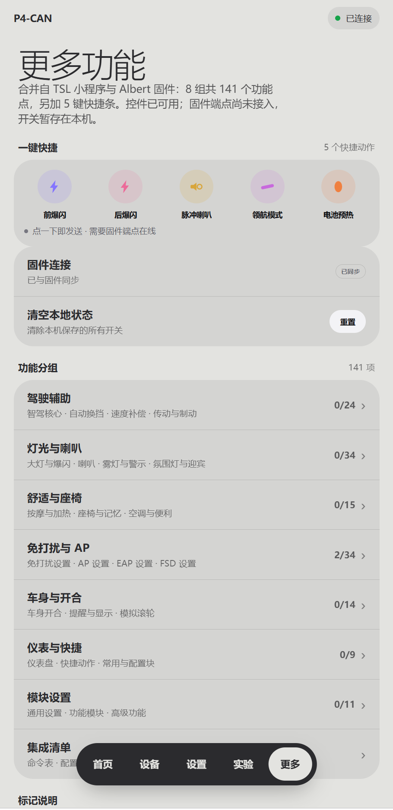

# P4can-unlock-more

## 免责声明

> **⚠️ 请先读完这一节再决定是否刷入。** 继续使用即视为你已阅读、理解并完全接受以下全部条款。
> **如果你不同意其中任何一条，请立即停止使用并删除本仓库的所有文件。**

### 1. 无关联、非官方

本项目是**个人独立研究与学习**的产物，与**特斯拉（Tesla, Inc.）及其关联公司没有任何关系**，未获其授权、认可或支持。项目中出现的车型名称、商标、协议名称仅用于说明兼容对象，所有权归各自权利人。

### 2. 不保证所有功能可用 —— 必须自己测试

**这一条最重要：本仓库不保证任何一个功能在你的车上能正常工作。**

- 「更多功能」页的 141 项中，只有标注 `A`（证据等级）的项是从反编译固件里读到真实位域偏移、掩码与命令字节，**但也只在作者的台架/单车上验证过**；标注 `B` 的项来自第三方界面设计图推断，**在固件中未能命中对应帧，很可能根本不生效**；标注 `C` 的项是纯前端行为，不涉及总线。
- `web_api.h` 中的 `/api/feifan/*` 五个端点**尚未实现**。这一版刷进去，页面开关能记住状态，但**不会真的发到 CAN 总线**。
- 不同年款、不同市场、不同软件版本的特斯拉，CAN 矩阵与配置块布局都可能不同。同一个位域在别人的车上有效，在你的车上可能无效，甚至可能触发意料之外的行为。
- **每一项功能都必须由你在安全环境下自行逐项验证**。不要因为界面上有个开关、显示「已开启」，就假定车真的照做了。界面状态不等于车辆状态。

### 3. 安全风险由你承担

本项目通过读写车辆 CAN 总线来改变车辆行为，涉及转向灯、远近光、喇叭、车门、后备箱、驻车与驾驶辅助相关逻辑。**任何一项误用都可能造成车辆损坏、交通事故、人身伤害或死亡。**

- 严禁在**公共道路、高速公路、载客、载货或任何有第三方在场**的场景下测试。
- 只能在**封闭场地、断网、无人的环境**下，由具备相应知识与资质的人员进行调试。
- 编程、刷写、调试期间**不要把车停在坡道、不要留人在车内、不要连接充电枪**。
- 你不确定某个操作后果时，**不要点它**。

### 4. 合法合规

在包括中国在内的许多国家和地区，**擅自改变车辆灯光、喇叭、制动灯行为，或屏蔽驾驶员监控提醒，属于违法行为**，可能导致车辆无法通过年检、被处罚，或使保险失效。你需要自行确认你的使用行为在当地合法，并自行承担全部法律责任。

本项目**不提供任何规避监管、伪造车辆状态、欺诈或用于营运的用途**。请勿将本项目用于上述目的。

### 5. 变砖、数据丢失与其他财产损失

刷写固件存在**设备永久性损坏（变砖）** 的风险。本仓库的镜像按 **32 MB Flash** 配置（`app5M_fat24M_32MB`）；**16 MB 板子刷入后连 bootloader 都无法启动**。OTA 升级只写 app 分区，无法更改 bootloader、分区表与 flash 参数，因此**某些错误无法通过网页 OTA 救回**，只能拆机 USB 重刷。

作者**不对**以下后果承担任何责任：设备变砖、Flash 数据丢失、车辆电子系统故障、ECU 报错、保修失效、4S 店或第三方维修费用、车辆贬值、行程延误，以及任何间接或附带的损失。

### 6. 无担保

本项目按 **「AS IS」（现状）** 提供，**不附带任何明示或暗示的担保**，包括但不限于适销性、特定用途适用性、无侵权、无缺陷、不中断、以及功能与文档描述一致的担保。文档、注释、提交信息、Release 说明中出现的「可用」「已验证」「实锤」等表述，仅描述作者在其自身环境下的观测结果，**不构成对你环境的任何承诺**。

### 7. 责任限制

在法律允许的最大范围内，**作者、贡献者与分发者均不对**因使用或无法使用本项目而产生的任何直接、间接、偶然、特殊、惩罚性或后果性损害承担责任，无论其基于合同、侵权、严格责任或其他法理，也无论是否已被告知该等损害的可能性。**你使用本项目的全部风险由你自行承担。**

### 8. 其他

- 本项目采用 MIT 许可证，许可证中的免责条款与本声明共同适用；两者冲突时，以更有利于作者免责的条款为准。
- 作者**没有义务**提供技术支持、修复缺陷、回复 Issue 或保证后续更新。
- 作者可**随时修改、暂停或删除**本仓库及任何发布，无需事先通知。
- 若你是车辆所有者以外的人（例如借用、租赁、代驾、维修人员），**请勿刷入**；刷入前必须取得车主的明确书面同意。
- 本声明如与当地强制性法律冲突，以当地法律为准，其余条款继续有效。

---

> [!WARNING]
> **只适用于 32 MB Flash 的板子**（微雪 ESP32-P4-WIFI6 / rev3.2）。
> **16 MB 版本刷这个包会直接变砖** —— 分区表 `app5M_fat24M_32MB` 与 16 MB flash 不匹配，烧进去连 bootloader 都起不来，只能用 USB 重新救回来。
> 16 MB 需要自己改 `large_fat_32MB.csv` 一类分区表、把 FQBN 里的 `FlashSize=32M` 换成 `16M`、`PartitionScheme` 换成 16 MB 方案，然后重新编译。仓库里没有现成的 16 MB 配置。

给 **Waveshare ESP32-P4 WiFi6 3×TWAI** 板子的特斯拉 CAN 工具固件。
在 [P4can-universal-unlock](https://github.com/06066060606060/P4can-universal-unlock) `v3.29.3` 的看板上，新增一页**「更多功能 / More features」**，并把固件更新面板补成能真正用的一次性流程。

**界面默认中文**，右上角语言开关可切英文，选择记在 `localStorage`，重启后保持。



---

## 先说清楚现状

> **不保证所有功能可用。** 141 项里有的只是从设计图推断出来的，有的后端端点还没写，
> 有的换个年款就不认。**每一项都要你自己在封闭场地上逐个测**，别把界面显示当结果。
> 详见上面的[免责声明](#免责声明)。

| | 状态 | 说明 |
|---|---|---|
| 「更多功能」页面 | ✅ 前端可用 | 8 组 141 项，中英双语，控件全部能点；**功能本身是否在你的车上生效未验证** |
| 固件更新（OTA） | ✅ 可用 | 网页上传 `.bin`，双分区 A/B，失败可回滚 |
| 本地模拟预览 | ✅ 可用 | `sim/p4can-sim.html`，双击即开，不需要板子 |
| 单项功能实效 | ⚠️ **未知** | `A` 级在作者单车上验证过，`B` 级为推断、可能完全无效，`C` 级不涉及总线 |
| **`/api/feifan/*` 后端端点** | ❌ **未实现** | 页面的读写动作目前只落在浏览器 `localStorage`，**还没有真的发到 CAN** |

最后一条是关键：这一版把**前端**完整接进了官方看板，`web_api.h` 里那 5 个端点仍是 TODO。
所以现在刷进去点开关，界面会记住状态，但车不会动。要真正生效见 [docs/PROTOCOL.md](docs/PROTOCOL.md)
里给出的帧与位域定义，按它补端点即可 —— 数据、页、打包链路都已经就位。

---

## 它做了什么

### 1. 更多功能页（8 组 / 141 项）

| 分组 | 项数 | 内容 |
|---|---|---|
| 驾驶辅助 | 24 | 自动换挡、打灯变道、AP 恢复策略、限速识别、驾驶员监控抑制 |
| 灯光与喇叭 | 34 | 脉冲远光/前雾/后雾、脉冲喇叭、动态刹车灯、迎宾灯效、氛围灯 |
| 舒适与座椅 | 15 | 座椅加热/通风/记忆、空调烘干、后视镜、方向盘加热 |
| 免打扰与 AP | 34 | Nag Killer 抑制、提示音、AP 自动开启/退出、超车加速 |
| 车身与开合 | 14 | 前备箱、后备箱、四门、充电口、后视镜折叠 |
| 仪表与快捷 | 9 | 仪表盘数据、滚轮按键、首页一键快捷 |
| 模块设置 | 11 | 总线速率、广播、日志、恢复默认 |
| 集成清单 | — | 追溯表：每一项来自哪个源、证据等级、对应帧/位域 |

每一项都标注了**证据等级**与**落地方式**：

- `A` — 实锤：位域偏移、掩码、命令字节直接读自反编译的 `SETTINGS` 数组
- `B` — 推断：来自界面设计图的命名与分组，未在固件中命中对应帧
- `C` — 本地：纯前端行为，无硬件依赖

写操作统一走 TSL 配置块：读 `byte[offset] >>> shift & mask`，清位后置值，
整块用 `CMD 163 (0xA3)` 回写。快捷键类动作走 `CMD 187 (0xBB)` 单字节值。

### 2. 固件更新面板

上游已经有可用的 `POST /update` + `GET /api/ota/status`，缺的是前端：
现在补上了分区余量、当前版本、拖拽选文件、大小/魔数预检、二次确认、
上传进度与 `Update.errorString()` 的错误码翻译。

### 3. 中英双语

页面顶部语言开关联动整站。动态拼接的文案（`Uploading 42%`）用
`MutationObserver` 兜底，中文模式下技术标识（帧 ID、位域、API、FQBN）保持原样。

---

## 刷机

到 [Releases](../../releases) 下载，两种包，按需选：

### 升级包 `*-ota.bin`（约 1.4 MB）—— 平时更新用

1. 手机/电脑连上 P4 的热点
2. 打开 `http://192.168.4.1` → **设置 → 固件更新**
3. 选 `P4can-unlock-more-v3.29.3-more1117-ota.bin`
4. 点一下，再点一下确认，等进度条走完自动重启

OTA 只写 app 分区，**改不了 bootloader、分区表和 flash 参数**。

### 完整包 `*-full.bin`（32 MB）—— 首次烧录 / 救砖用

```bash
esptool.py --chip esp32p4 -p <PORT> -b 460800 write_flash 0x0 P4can-unlock-more-v3.29.3-more1117-full.bin
```

整片镜像布局（ESP32-P4 与 S3 不同，`0x0` 是空白 `0xFF`）：

| 偏移 | 内容 |
|---|---|
| `0x2000` | bootloader（magic `E9`） |
| `0x8000` | 分区表（magic `AA50`） |
| `0x10000` | 应用镜像（magic `E9`） |

每个 Release 都附 `manifest.json`，含两个包的 sha256、大小、分区余量、
FQBN 与页面指纹，刷完可以对照页面上的版本号核对。

---

## 从源码编译

需要 **Arduino-ESP32 core 3.3.12** 与 `arduino-cli`（或 Arduino IDE 2.x）。

```text
esp32:esp32:esp32p4:ChipVariant=postv3,FlashSize=32M,PartitionScheme=app5M_fat24M_32MB,PSRAM=enabled,USBMode=hwcdc,CDCOnBoot=cdc,FlashMode=qio
```

`firmware/P4can-unlock-more/` 就是 sketch 目录，直接用 IDE 打开即可编译。

### 一条命令出两个包

```bash
python tools/more/pack_ota.py            # 重建页面 → 编译 → 出包 → 校验
python tools/more/pack_ota.py --no-html  # 页面没改，跳过 gzip 重建
python tools/more/pack_ota.py --dry-run  # 只检查环境
```

脚本会做 7 步，任一步不合规直接中止：

1. 重跑 `gen_feifan.py` → `integrate_feifan.py` → `patch_ota.py`，再 gzip 成 `index_html.h`
2. 同步源码到 `build/` 编译副本，改写 `FW_VERSION` 打版本标
3. `arduino-cli compile`
4. 提取 `.ino.bin`，校验大小 ≤ `0x480000`、首字节 `0xE9`
5. 提取 `.merged.bin`，校验 32 MB 与三个关键偏移
6. **逐字节比对**镜像内嵌 gzip 与 `dashboard_source.html`（防止页面没同步进去）
7. 写 `dist/manifest.json`

`arduino-cli` 找不到时按 `ARDUINO_CLI` 环境变量 → `PATH` → `tools/` 顺序查找。

---

## 本地预览（不刷板）

```bash
python tools/more/build_sim.py
```

从 `index_html.h` 解出页面，注入假后端，输出 `sim/p4can-sim.html`。
双击打开即可点完整流程：假 `/api/feifan/*`、假 OTA 进度、右下角 SIM 面板
能看到每个请求的方法、路径、payload 与最近动作。

> 这是调试页面用的，不能替代真机验证。

---

## 目录结构

```text
firmware/P4can-unlock-more/     固件 sketch（.ino + 头文件 + 页面）
  dashboard_source.html         可编辑的看板源码（注入块标了 P4CAN-* 注释）
  index_html.h                  由它 gzip 生成的嵌入头，不要手改
  tools/                        上游自带的构建脚本
tools/more/
  build_more.py                 合并三路来源 → data/feifan-menu-data.json
  gen_feifan.py                 生成页面/CSS/JS/翻译片段
  integrate_feifan.py           5 处注入看板（幂等，先删旧块）
  patch_ota.py                  固件更新面板增强（幂等）
  pack_ota.py                   编译 + 出包 + 校验
  build_sim.py                  生成本地模拟页
data/feifan-menu-data.json      141 项功能 + 44 个位域 + 命令/API 定义
docs/                           FEATURES / PROTOCOL / OTA / REVERSE
sim/p4can-sim.html              本地模拟页（可直接打开）
```

---

### 详细文档

| 文档 | 内容 |
|---|---|
| [docs/FEATURES.md](docs/FEATURES.md) | 141 项功能全表，逐项标注证据等级、帧/位域、落地方式 |
| [docs/PROTOCOL.md](docs/PROTOCOL.md) | 帧格式、命令字、44 个位域、`0xBB` 快捷键值、前端契约 |
| [docs/OTA.md](docs/OTA.md) | 分区/回滚机制、打包 7 步、验收清单、离线校验 |
| [docs/REVERSE.md](docs/REVERSE.md) | 三路来源怎么拆的、纠错记录、去重决策、还没搞清的 |

---

## 硬件与接线

板子：Waveshare ESP32-P4-WIFI6，rev3.2，32 MB flash，`app5M_fat24M_32MB` 分区。
`ota_0` / `ota_1` 各 `0x480000`（4.5 MB），单包上限 4,718,592 B。

| 总线 | TWAI | TX | RX |
|---|---|---|---|
| CAN 1 BODY | 0 | GPIO20 | GPIO21 |
| CAN 2 CHASSIS | 1 | GPIO22 | GPIO23 |
| CAN 3 PARTY | 2 | GPIO26 | GPIO27 |

---

## 已知限制

- `web_api.h` 里 `/api/feifan/{status,config,action,gauge,blob}` 五个端点未实现，
  页面写入不落 CAN。这是本版最大的缺口。
- 设计图上的 `0x249 / 0x10C / 0x3E2 / 0x3E3` 在 Albert 固件与 P4 源码里命中 0 次，
  这几个功能已按真实位域重写，帧号只作脚注保留，别照着发帧。
- 分区表、bootloader、flash 参数只能线刷，OTA 无法更改。
- 没有在实车上验证过任何一项写入行为。

---

## 安全与合规

完整条款见顶部[免责声明](#免责声明)，这里只留可执行的三条：

- 只在**封闭场地**调试；不要在公共道路使用影响灯光、喇叭、限速识别的功能
- 刷机前先确认你有办法救砖（完整包 + USB 线）
- **每一项功能都要自己验证**，界面显示「已开启」不代表车真的执行了

与特斯拉公司无任何关联。特斯拉、Model 3/Y 等商标归其所有者。

---

## 致谢

- [P4can-universal-unlock](https://github.com/06066060606060/P4can-universal-unlock) —— 固件基线
- [204442021](https://github.com/204442021) —— 功能清单与逆向素材
- [P4can-universal-unlock 生态](https://github.com/06066060606060) 的其他贡献者

## ☕ 赞助

> 项目完全开源免费。如果它帮你省下了折腾的时间，欢迎请作者喝杯咖啡，助力后续更新~

<table>
  <tr>
    <td align="center"><br><sub><b>支付宝</b></sub></td>
    <td align="center"><br><sub><b>微信支付</b></sub></td>
  </tr>
</table>

## 📮 联系作者

> 装不上、刷完了没反应、想加功能，都可以来找我。

<table>
  <tr>
    <td align="center"><br><sub><b>抖音 · @耶基大学懂事长</b><br>抖音号 <code>yejiuni</code></sub></td>
    <td align="center"><br><sub><b>微信 · 扫码加好友</b></sub></td>
  </tr>
</table>

## License

新增部分 MIT，见 [LICENSE](LICENSE)；固件基线的版权与条款见 [NOTICE](NOTICE)。

---

[English](README.en.md)
